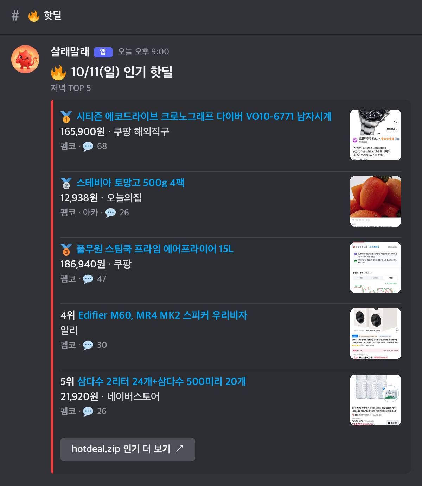
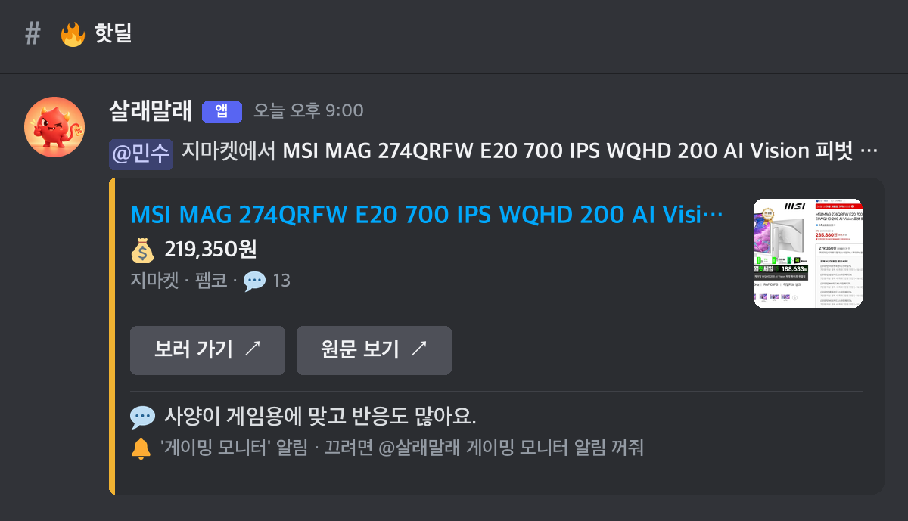

<p align="center"></p>

<h1 align="center">살래말래</h1>

친구들 디스코드 핫딜 스레드에 **오늘의 인기 핫딜**을 골라 올리고, 친구들이 걸어둔 관심사에 맞는 딜이 뜨면 그 사람에게 알려 주는 봇입니다.

- 왓딜(펨코·뽐뿌·아카라이브·퀘이사존·어미새…)과 루리웹·클리앙의 새 딜을 모아, 댓글·추천 반응으로 순위를 매깁니다. 같은 딜과 같은 행사는 한 줄로 묶습니다.
- **🔥 인기 TOP 5**는 12시·21시, **🎮 게임 · 💻 IT · 🍜 식품 TOP 5**는 12시에 올립니다.
- `@살래말래 메가커피 뜨면 알려줘`처럼 말하면 Gemini가 알아듣고 알림을 걸어 줍니다. "괜찮은 게이밍 모니터"처럼 종류로 말해도 됩니다.
- GitHub Actions에서 돌며 서버가 필요 없습니다 ([cron-job.org](https://cron-job.org)가 15분마다 실행).

## 카드 예시

> 디스코드에 올라오는 모습입니다 (누르면 크게). 실제 딜로 만들었고 멘션만 가명입니다 ([tools/readme_cards.py](tools/readme_cards.py)).

<p>
  <a href="docs/images/card-hot.png"></a>
  <a href="docs/images/card-alert.png"></a>
</p>

- **TOP 5**: 순위 · 제목(원문 링크) · 가격 · 쇼핑몰 · 출처 · 💬댓글 · 👍추천, 상품 사진, 맨 아래 더 보기 버튼
- **관심사 알림**: 대상자만 태그(스레드는 조용히, 본인에게 DM) · AI가 고른 이유 · 쇼핑몰·원문 버튼

## 디스코드에서 쓰기

| 말하면 | 봇이 하는 일 |
|---|---|
| `@살래말래 메가커피 뜨면 알려줘` | 알림 등록 |
| `@살래말래 게이밍 모니터 50만원 이하 뜨면 @진호 한테 한 번만 알려줘` | 진호에게 알림 등록 (종류는 AI가 판단) |
| `@살래말래 메가커피 올라왔어?` | 최근 3일 딜에서 검색 |
| `@살래말래 내 알림` / `다들 뭐 걸어놨어?` / `메가커피 알림 꺼줘` | 목록 · 전체 목록 · 해제 |

15분마다 확인해서 답이 조금 늦을 수 있습니다. 스레드에 고정된 **🔔 알림 키워드**에 전체 알림 목록이 있습니다.

## 실행

```bash
python3 -m venv .venv && .venv/bin/pip install -r requirements.txt
cp .env.example .env                       # 봇 토큰·채널 ID·Gemini 키
.venv/bin/python -m app cycle --dry-run    # 전송 없이 한 번 돌려보기
```

## 문서

| 문서 | 내용 |
|---|---|
| [docs/setup.md](docs/setup.md) | GitHub Actions 비밀값·cron-job.org 설정, 로컬 실행 |
| [docs/how-it-works.md](docs/how-it-works.md) | 출처, 순위 매기기, 글·알림·@멘션 동작 |
| [docs/flow.html](docs/flow.html) | 흐름도 |
| [docs/versions.md](docs/versions.md) | 버전별 변화 (알구몬 → hotdeal.zip → Actions) |

Python · requests · BeautifulSoup · Gemini · Discord REST (Components V2).
